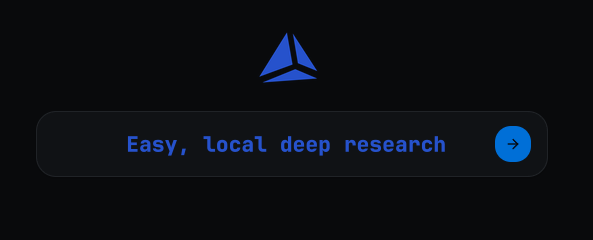

# Atlas

A deep research agent that connects to LM Studio for local LLM inference and uses crw (MCP server) for web research capabilities.



## Overview

Atlas is a desktop application built with Tauri 2, React 19, and TypeScript 6. It acts as an MCP (Model Context Protocol) client that:

- **Orchestrates research** using local LLMs via LM Studio (OpenAI-compatible `/v1/chat/completions`)
- **Dispatches web research tools** via crw MCP server (web search, scraping)
- **Runs a ReAct tool loop** locally in the app (not in LM Studio) to avoid SSRF issues
- **Manages subagents** via in-memory mailbox for parallel research tasks

## Architecture

```
┌─────────────┐     OpenAI-compatible      ┌─────────────┐
│    Atlas    │─────────────────────────▶│  LM Studio  │
│  (Tauri + React)│◀─────────────────────────│  (local LLM)│
└──────┬──────┘   tool calls (tool-role)    └─────────────┘
       │
       │ MCP over HTTP
       ▼
┌─────────────┐
│    crw      │  (MCP server: web search, scrape, etc.)
│  (localhost)│
└─────────────┘
```

**Key architectural decision**: The app is the MCP client, not LM Studio. LM Studio's `integrations`/`ephemeral_mcp` is NOT used (SSRF guard rejects loopback). Instead, `tool-loop.ts` calls `mcp-client.ts` directly, then feeds results back as tool-role messages.

## Prerequisites

- **LM Studio** running at `http://localhost:1234` (or configured URL)
- **crw** MCP server running at `http://localhost:3100` (or configured URL)
- **Node.js** 20+ and **Rust** 1.78+ for development
- **JDK 17+** for Android builds

## Quick Start

```bash
# Install dependencies
npm install

# Start development server (Vite + Tauri)
npm run dev          # Vite dev server only
cargo tauri dev      # Tauri dev window (native)

# Build for production
npm run build        # Vite build
cargo tauri build    # Desktop distributable
cargo tauri android build  # Android APK/AAB
```

## Configuration

Settings are persisted to `localStorage` under `deep-research-config`:

- **LM Studio URL** — Default `http://localhost:1234`
- **crw URL** — Default `http://localhost:3100`
- **crw API Key** — Optional, for authenticated crw instances
- **Orchestrator Model** — Model used for planning/tool orchestration
- **Subagent Model** — Model used for subagent research tasks
- **Toolset** — Resolved once from crw on connection; re-resolved when crw URL changes

History persists under `deep-research-history` (max 20 entries).

## Key Implementation Details

| File | Purpose |
|------|---------|
| `src/lib/tool-loop.ts` | ReAct loop: calls LM Studio, dispatches tool calls via MCP client, feeds results back |
| `src/lib/mcp-client.ts` | MCP-over-HTTP client talking to crw |
| `src/lib/openai-compat.ts` | Streaming OpenAI-compatible chat completions client |
| `src/lib/api.ts` | LM Studio REST client (listModels, streamChat) |
| `src/lib/store.ts` | Zustand store with localStorage persistence |
| `src/lib/mailbox-local.ts` | In-memory subagent messaging (no separate server) |
| `src/components/research-chat.tsx` | Main UI orchestrating research flow |

**Quirks to know:**
- Tool results are truncated (`MAX_TOOL_RESULT_CHARS=6000`) and older results compacted to 800 chars
- Tool dispatch is concurrent (`Promise.all` in `tool-loop.ts:287`)
- `SubagentState.report` is the source of truth for subagent conclusions (not SSE deltas)
- `store.reset()` preserves `orchestratorModel`, `subagentModel`, `toolset`, `lmStudioUrl`
- CSP is `null` in Tauri config — webview allows any outbound request

## Android Build

Requires:
- JDK 17+ (not 1.8)
- Android SDK with NDK r28 at `$ANDROID_HOME/ndk/28.2.13676358`
- Rust targets: `aarch64-linux-android`, `armv7-linux-androideabi`, `i686-linux-android`, `x86_64-linux-android`

```bash
cargo tauri android build
```

## Stack

- **Frontend**: React 19, TypeScript 6.0 (erasableSyntaxOnly), Vite 8, Tailwind CSS v4
- **Desktop**: Tauri 2 (Rust, thin shell — app logic is TypeScript)
- **State**: Zustand with localStorage persistence
- **UI**: shadcn/ui (base-nova style), lucide-react, cmdk
- **Fonts**: Inter (body), Space Grotesk (headings) via @fontsource
- **Linting**: Oxlint (not ESLint) — `npm run lint`